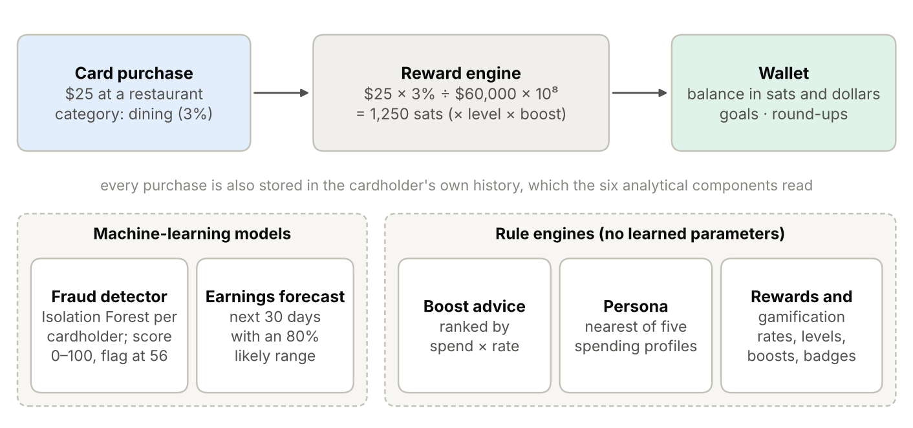
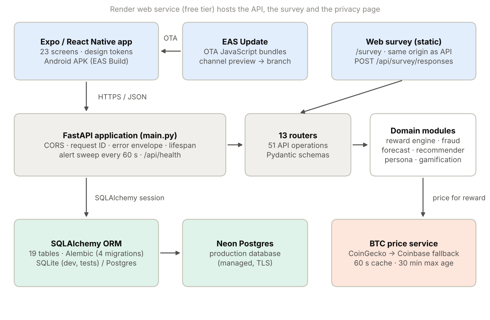
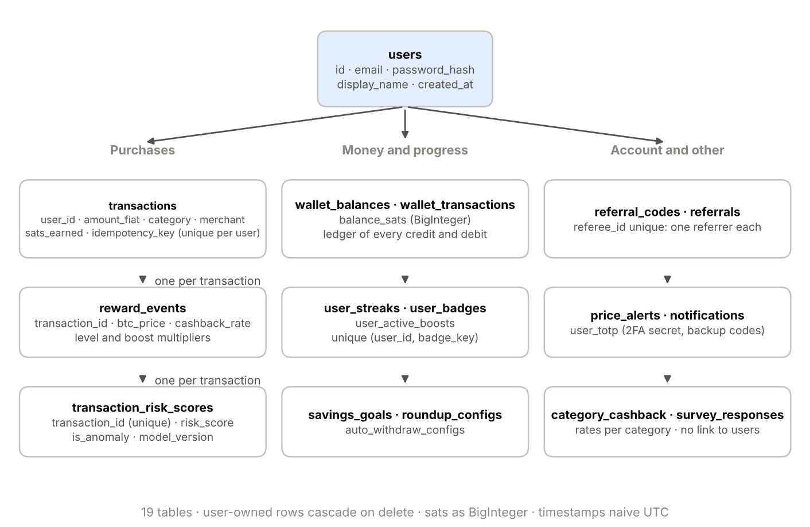
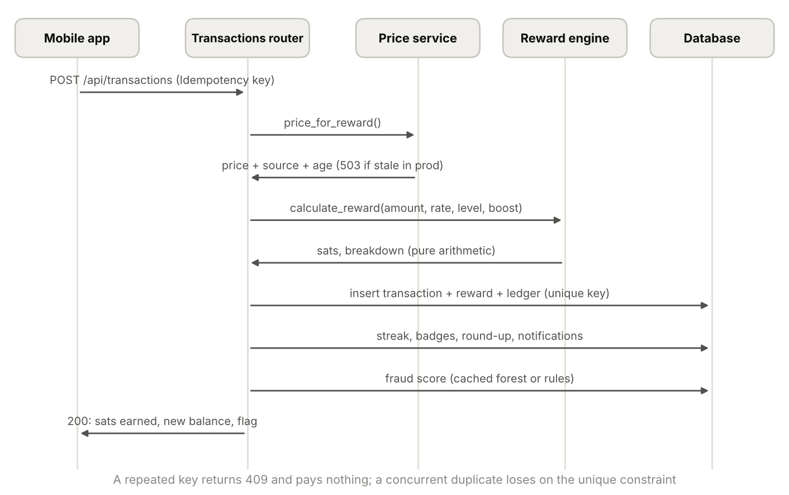
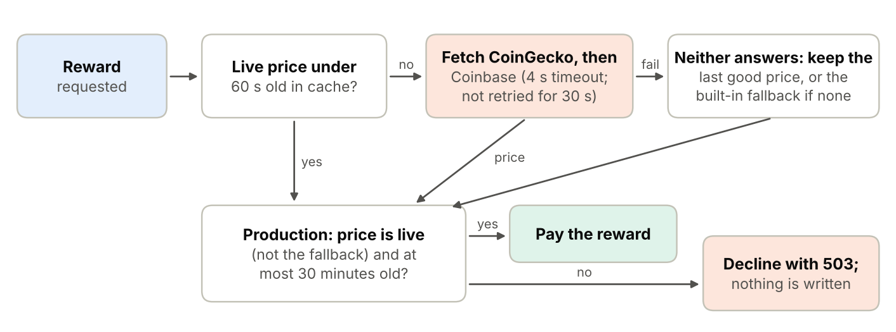
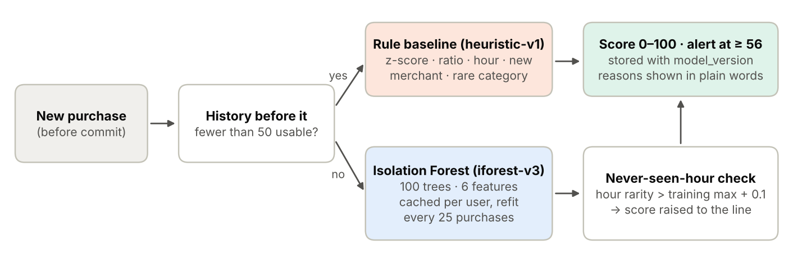
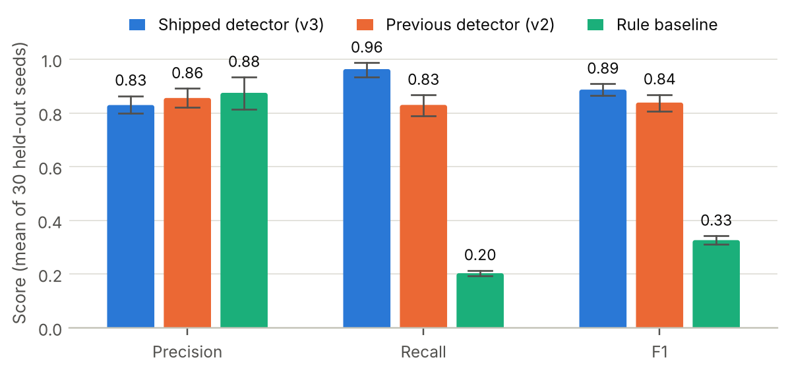
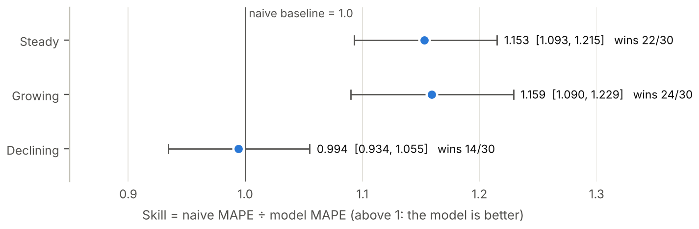
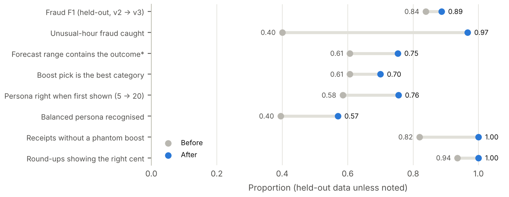
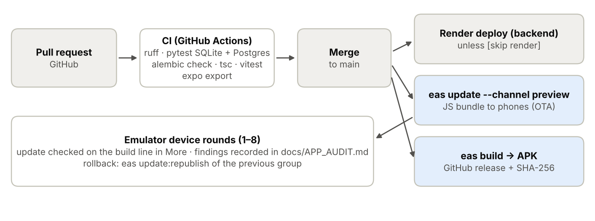

# BitBack architecture

How the system is put together: the parts, how they talk to each other, the
data they keep, and how a purchase, a reward and a release flow through them.
Every count here was taken from the code. For the evaluation of the models
and rule engines, see [EVALUATION.md](EVALUATION.md); for security and
reliability work, [BACKEND_HARDENING.md](BACKEND_HARDENING.md); for the app
audit and device testing, [APP_AUDIT.md](APP_AUDIT.md).

The [23 October 2026 architecture review](ARCHITECTURE_REVIEW.md) checks this
description against commit `0254016` and includes its verification evidence.
Two findings remain open in that code: the fraud model's cache can stop
refreshing when its 500-purchase history window fills, and an offline cold
launch can route a valid session to sign-in. The review records these findings;
no runtime fix is included in this documentation update.

## The idea

A card purchase earns cashback in satoshis (sats; 1 bitcoin = 100,000,000
sats) at the live bitcoin price. Six analytical components then read the
cardholder's own history: two machine-learning models and four rule engines.



## Components



| Part | Technology | What it does |
|---|---|---|
| Mobile app | Expo SDK 54, React Native 0.81, expo-router | 23 screens; Android APK through EAS Build; over-the-air updates through EAS Update |
| API | Python 3.11, FastAPI, Pydantic | 51 API operations in 13 router modules; request IDs, one error format, rate limits |
| Domain modules | Plain Python, NumPy, scikit-learn | Reward engine, fraud detector, forecast, boost recommender, persona, gamification |
| Database | SQLAlchemy, Alembic (4 migrations) | 19 tables; SQLite in development and tests, Postgres (Neon) in production |
| Price service | CoinGecko, then Coinbase | Bitcoin price with a 60-second cache; never pays at a stale or invented price |
| Web survey | Static page served by the API | Research survey that posts to the same API |
| Hosting | Render (free tier) | API, survey and privacy page; sleeps when idle |
| CI | GitHub Actions | Lint and tests on SQLite and Postgres, migration check, mobile typecheck, tests and bundle |

The analytical components run inside the API process, on the request path.
That keeps the free deployment to one process, at the cost of holding the
fraud models and rate-limit counters in memory, which is why the server runs
as a single worker.

## Code layout

```
main.py                  app assembly: config, middleware, lifespan, routers
app/
  routers/               13 modules, one per resource group
  reward_engine.py       cashback arithmetic, levels, round-ups (no database access)
  anomaly_detector.py    Isolation Forest fraud scoring, per cardholder
  ml_forecast.py         30-day earnings forecast with an 80% interval
  smart_recommender.py   boost ranking by expected value
  spending_persona.py    nearest-profile persona classifier
  gamification.py        streaks and badges
  btc_service.py         bitcoin price with source, age and fallbacks
  auth.py, rate_limit.py JWT, bcrypt, TOTP; per-address and per-account limits
  models.py, schemas.py  19 tables; request and response validation
evaluation/              harness that evaluates all six components
migrations/              Alembic schema history
tests/                   243 backend tests
mobile/
  app/                   23 screens (file-based routes)
  components/, lib/      shared UI, design tokens, API client, 75 tests
```

## Data model



- Sats are stored as 64-bit integers, never floats, so balances are exact.
- Every purchase has one reward event recording the price, rate and
  multipliers used, so any reward can be recomputed and audited.
- The wallet is a balance plus a ledger of every credit and debit.
- Each purchase may carry an idempotency key, unique per user, which the
  database enforces: a retried purchase is never paid twice.
- Survey responses have no link to users: the survey is anonymous.

## A purchase, step by step



1. The app sends `POST /api/transactions` with an `Idempotency-Key`.
2. The router applies a rate limit (20 purchases a minute per user) and asks
   the price service for a price that is safe to pay against.
3. The reward engine computes
   `sats = amount × rate ÷ price × 10^8 × level multiplier × boost multiplier`.
4. The purchase, its reward event and a ledger credit are written; round-up
   sats, streak, level, badges, the fraud score and notifications follow.
5. Everything commits together, so a failure leaves no partial purchase. A
   repeated key gets `409` and pays nothing.

### When a reward may be paid



In production a reward is declined with `503` if the only price available is
the built-in fallback or is more than 30 minutes old.

### How a purchase is scored for fraud



Six features describe each purchase relative to the cardholder's own history
(amount, category, time since the last purchase, hour, size against the
overall average, new merchant). From about the 70th purchase, an Isolation
Forest fitted to that cardholder's history scores it 0–100 and flags it at 56.
Before that, a transparent rule set scores it. Models are cached per
cardholder and refitted every 25 purchases.

## Models and rule engines

| Component | Kind | How it decides |
|---|---|---|
| Fraud detector | Machine learning | Per-cardholder Isolation Forest, plus a check for hours never seen before |
| Earnings forecast | Statistical model | Weekly level smoothing blended with the window mean; 80% prediction interval |
| Boost recommender | Rule engine | Ranks categories by spend × base rate over the last 60 days |
| Spending persona | Rule engine | Most similar of five designed profiles, shown after 20 purchases |
| Reward engine | Rule engine | Category rate × level multiplier × optional 2× boost |
| Gamification | Rule engine | Ten badges, five levels, a daily streak |

All six are evaluated against simple baselines on held-out synthetic data,
with 95% confidence intervals. Selected results:







Full method and results: [EVALUATION.md](EVALUATION.md).

## Security

- Passwords hashed with bcrypt; sessions are HS256 JWTs with a purpose claim
  and a password fingerprint, so a password change signs out every device and
  a reset link works once.
- Optional TOTP two-factor authentication with backup codes.
- Rate limits per address and, where guessing is the threat, per account.
- Production refuses to start with a weak secret, demo mode or SQLite.
- On the phone, the session token is kept in the Android Keystore or iOS
  Keychain.
- Accounts can be deleted in the app; a test checks that no row referring to
  the user survives.

## Release



- Every change runs through CI.
- The API is deployed on Render; the database is Neon Postgres.
- The Android app is built with EAS Build and published as a GitHub release
  with its SHA-256 checksum. JavaScript changes reach installed apps as
  over-the-air updates on the `preview` channel (runtime 1.0.0).
- The iPhone beta is distributed through TestFlight.

## Reproducing

```bash
pip install -r requirements.txt
alembic upgrade head && python seed_demo.py
uvicorn main:app --host 0.0.0.0 --port 8000
pytest                       # backend tests
python -m evaluation.run     # every evaluation number, about 10 minutes
cd mobile && npm ci && npm test
```
