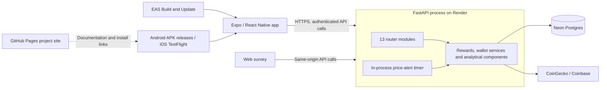

# BitBack architecture review

Reviewed: 23 October 2026, Singapore time.

Repository: https://github.com/JEEPSSS/Bitcoin-cashback-system

Snapshot: [025401622bd36297aaf05db45771d5dea4b2a736](https://github.com/JEEPSSS/Bitcoin-cashback-system/commit/025401622bd36297aaf05db45771d5dea4b2a736), branch main.

This was a read-only architecture review of the source snapshot above. GitHub CLI 2.101.0 was used to inspect repository metadata, the file tree, source files and CI results. Five key source files fetched with the CLI matched the reviewed clone byte for byte. No repository changes, builds, submissions, deployments, OTA updates, live API requests or database operations were performed.

Publication note: this documentation update records the completed review and its evidence. It does not implement the recommended fixes; findings 1 and 2 remain open in the reviewed code.

Mirror provenance: this review was first published in the [new repository](https://github.com/JEEPSSS/Credit-card-with-bitcoin-cashback-system-BitBack/blob/e533bf2/docs/ARCHITECTURE_REVIEW.md). Before mirroring it here, all 159 tracked non-documentation files were compared by Git blob ID and matched. This repository's snapshot, five application files and existing CI result were also verified separately with GitHub CLI. Source links and snapshot IDs below use this repository's history. The isolated checks were reused because the checked implementation is identical. Historical commit references in APP_AUDIT.md are preserved for this repository. [Runtime comparison evidence](architecture-review/runtime-parity.json).

## Assessment

BitBack is a modular monolith with a separate mobile client. Its size and deployment model suit a final-year prototype. The strongest parts are the separation of the reward calculation from database code, the transaction and ledger design, and checks against both SQLite and Postgres in CI.

The first two issues to address are a fraud-cache invalidation error at the 500-purchase history limit and offline session restoration at app startup. Both have isolated, local evidence below. Device behavior and live deployment settings were not retested in this review.

GitHub CLI retrieves repository information; it does not itself analyse or understand the architecture. The conclusions below come from tracing the retrieved code.

## System map

The project site is a static presentation layer. The API separately serves the survey and privacy page. Neither the Pages site nor the phone runs the database or the fraud model.

| Component | Observed implementation |
|---|---|
| Mobile | Expo SDK 54, React Native 0.81.5, React 19.1.0, Expo Router |
| Screens | 23 screen route files; excludes layouts and the root redirect |
| API | 51 `/api/` operations, including health and client-IP metadata; 13 router modules |
| Data | 19 SQLAlchemy tables; four Alembic migrations |
| Value storage | Integer satoshi balances and ledger entries; purchase prices and fiat amounts also stored |
| Authentication | bcrypt, purpose-scoped JWTs bound to the current password hash, optional TOTP |
| Analytics | Isolation Forest, statistical earnings forecast, expected-value boost ranking, designed-profile persona matching, reward arithmetic and gamification |
| Price integration | CoinGecko followed by Coinbase; cache, failed-fetch backoff, source and age metadata |
| Delivery | Preview Android APK and preview OTA channel; production build profile for iOS/TestFlight |
| Website | GitHub Pages, independent of the runtime API |

Counts were calculated from code without importing or starting the application. There are 50 operations in router modules, including `/privacy`; excluding that non-API operation and adding the two `/api/` operations in main.py gives 51 API operations.

## What is already well designed

- **Purchase consistency:** the purchase, reward, wallet credit, ledger, badges, risk record and notifications commit together. The wallet uses a row lock. A database uniqueness constraint on user and idempotency key prevents a repeated key from paying twice. Replays return 409 rather than replaying the original receipt; that is an explicit prototype tradeoff. [Purchase route](https://github.com/JEEPSSS/Bitcoin-cashback-system/blob/0254016/app/routers/transactions.py#L63), [wallet service](https://github.com/JEEPSSS/Bitcoin-cashback-system/blob/0254016/app/services.py#L45).
- **Domain separation:** reward arithmetic is independent of database access; HTTP handlers call shared services and analytical modules. This makes the core rules easier to test. [Reward engine](https://github.com/JEEPSSS/Bitcoin-cashback-system/blob/0254016/app/reward_engine.py).
- **Price integrity:** production reward creation refuses a fallback or over-age price. The user-facing price response can explain its freshness. [Price service](https://github.com/JEEPSSS/Bitcoin-cashback-system/blob/0254016/app/btc_service.py).
- **Session controls:** access and reset tokens carry a purpose and password fingerprint. The mobile interceptor distinguishes an authenticated 401 from a wrong-password response or network failure. A separate startup path still has the issue described below. [Server authentication](https://github.com/JEEPSSS/Bitcoin-cashback-system/blob/0254016/app/auth.py#L58), [mobile session rules](https://github.com/JEEPSSS/Bitcoin-cashback-system/blob/0254016/mobile/lib/session.ts).
- **Operational checks:** request IDs, consistent error responses, database-aware health checks, migration validation and Postgres-specific concurrency tests are present. The reviewed commit's backend, Postgres and mobile CI jobs all report success. [CI run](https://github.com/JEEPSSS/Bitcoin-cashback-system/actions/runs/39262930253).
- **Research data separation:** survey responses have no user foreign key, and app-experience answers are analysed by whether the respondent used the app. This review did not inspect any survey responses.

## Findings to address

### 1. Fraud models can stop refreshing when history reaches its limit

**Priority: first fixes. Evidence: code inspection and isolated execution of the actual cache-decision helper.**

The fraud query reads at most 500 historical purchases. Cache freshness compares `len(history)` with `trained_at_size`, and refits after a difference of 25. Once the window is full, the length stays at 500 while its contents keep changing. A model fitted at size 495 or 500 therefore keeps being considered fresh. It can remain resident indefinitely until eviction, explicit invalidation or process restart.

This breaks the intended rule that the model refreshes after 25 new purchases. It affects later scores; it does not alter the wallet or rewrite earlier risk records.

The isolated check produced:

| Model trained at | Current capped history length | Requests a refit? |
|---:|---:|---|
| 475 | 500 | Yes |
| 495 | 500 | No |
| 500 | 500 | No |

Track a monotonic transaction count or a new-record marker separately from the bounded training window. A regression test should continue adding purchases beyond the window limit and confirm subsequent refits.

Source: [history limit](https://github.com/JEEPSSS/Bitcoin-cashback-system/blob/0254016/app/anomaly_detector.py#L58), [cache decision](https://github.com/JEEPSSS/Bitcoin-cashback-system/blob/0254016/app/anomaly_detector.py#L209), [bounded query and cache lookup](https://github.com/JEEPSSS/Bitcoin-cashback-system/blob/0254016/app/anomaly_detector.py#L265).

Evidence: [cache decision check](architecture-review/cache-decision-evidence.json). No full forest training or live request was performed.

### 2. A cold launch while offline can route a valid session to login

**Priority: first fixes. Evidence: code inspection and isolated execution of the actual refresh body with a simulated network error.**

AuthProvider calls `/api/auth/me` when a stored token exists. Its refresh catches every error and sets the current user to null. The root route then sends a null user to login. A network failure therefore produces the login UI even though the stored token has not been cleared or shown to be invalid.

The existing interceptor correctly limits session clearing to relevant 401 responses; the startup catch bypasses that distinction. Existing offline-refresh tests do not establish that a fresh app launch offline works.

Represent session restoration states explicitly: loading, authenticated, unavailable/offline and expired. Offer a retry for transient failures; handle authenticated 401 responses as expiry. Any cached profile would be for display only, with the server continuing to authorize operations.

Source: [refresh and startup](https://github.com/JEEPSSS/Bitcoin-cashback-system/blob/0254016/mobile/lib/auth.tsx#L42), [initial route](https://github.com/JEEPSSS/Bitcoin-cashback-system/blob/0254016/mobile/app/index.tsx#L10).

Evidence: [offline session check](architecture-review/offline-session-evidence.json). The actual refresh body set the user to null when the fake API rejected. This was not an emulator or end-to-end test.

### 3. Home has an avoidable shared failure boundary

**Priority: performance and resilience improvement. Evidence: static inspection; no latency benchmark.**

Home loads wallet, price, rewards, recent purchases, forecast and notifications through one Promise.all. On an initial load, one optional endpoint failing prevents the whole combined result from being displayed. The focus-loading hook also refetches on every focus without a shared cache. Warm screens can retain prior data, which helps, but this does not remove the initial-load coupling.

Load essential balance/activity data separately from optional forecast/notification data. Add shared, bounded caching and request deduplication before considering a larger backend redesign. Cancel or ignore superseded loads so a late response cannot overwrite a newer result.

Source: [Home's six requests](https://github.com/JEEPSSS/Bitcoin-cashback-system/blob/0254016/mobile/app/%28tabs%29/index.tsx#L26), [focus-loading hook](https://github.com/JEEPSSS/Bitcoin-cashback-system/blob/0254016/mobile/lib/useApi.ts#L32).

### 4. API contracts need a shared source of truth

**Priority: maintenance improvement. Evidence: static inspection.**

The phone maintains handwritten TypeScript response types. Several analytical endpoints return dictionaries without a declared response model or return annotation; `/api/forecast` is one example. TypeScript therefore checks the assumed client shape, not the actual Python response. The forecast type's comment records the earlier field-name mismatch and crash.

Declare backend response schemas, including insufficient-history variants, then generate client types or enforce equivalent cross-language contract checks in CI. The current corrected fields match in the paths inspected; this is a drift risk rather than a claim that the current forecast screen still crashes.

Source: [forecast route](https://github.com/JEEPSSS/Bitcoin-cashback-system/blob/0254016/app/routers/ml.py#L19), [client forecast type](https://github.com/JEEPSSS/Bitcoin-cashback-system/blob/0254016/mobile/lib/types.ts#L226).

## Existing limits and product boundaries

| Item | Evidence and implication |
|---|---|
| Single-process state | Rate limits, model cache and price cache live in memory; the alert timer starts in the API lifespan. Multiple workers would need shared coordination. Keep the documented single-worker setup until that design changes. |
| Sleeping service | The in-process alert timer cannot work while the host sleeps. The app's shared wake check helps interactive requests, but does not provide continuous background alert delivery. |
| Two-factor secret storage | TOTP seeds and recovery codes are stored unencrypted; recovery codes are compared directly. This is already disclosed in BACKEND_HARDENING.md. Before a broader production rollout, design protected seed storage, hashed recovery codes and replay protection. No stored secrets were read in this review. |
| Auto-withdraw | The inspected code stores and returns configuration. No threshold-processing withdrawal worker or withdrawal operation was found. The UI's promise to send sats is stronger than the implemented capability; explain this clearly during the demo. |
| Time zones | Display timestamps are interpreted as UTC then shown locally, but streak-day rules remain UTC. The code documents the need for a per-user timezone. |
| Release configuration | Both build profiles inherit the live API URL. OTA commands need their own environment handling; build-profile env inheritance does not itself prove an OTA export used that URL. Native changes also need a deliberate compatible-runtime/version decision. |
| CI platform coverage | CI includes an Android export. An equivalent iOS export would improve coverage now that an external iPhone beta is available. It would not replace device testing or a signed build. |

Sources: [single-worker deployment](https://github.com/JEEPSSS/Bitcoin-cashback-system/blob/0254016/DEPLOY.md#L67), [alert timer](https://github.com/JEEPSSS/Bitcoin-cashback-system/blob/0254016/main.py#L97), [documented security limits](https://github.com/JEEPSSS/Bitcoin-cashback-system/blob/0254016/docs/BACKEND_HARDENING.md#L309), [withdrawal settings](https://github.com/JEEPSSS/Bitcoin-cashback-system/blob/0254016/app/routers/preferences.py#L38), [UTC day rules](https://github.com/JEEPSSS/Bitcoin-cashback-system/blob/0254016/app/clock.py#L13), [EAS profiles](https://github.com/JEEPSSS/Bitcoin-cashback-system/blob/0254016/mobile/eas.json), [CI configuration](https://github.com/JEEPSSS/Bitcoin-cashback-system/blob/0254016/.github/workflows/ci.yml).

## Validation and limits of this review

| Check | What was actually observed |
|---|---|
| GitHub CLI | Installed 2.101.0; authenticated after the user completed sign-in privately; used read-only commands |
| Snapshot | CLI's main commit matches the clone: 0254016 |
| Source comparison | main.py, fraud code, mobile auth, purchase route and EAS profiles matched the CLI-fetched files byte for byte |
| CI | Existing run 39262930253 reports success for mobile, backend and Postgres jobs; it was not rerun |
| Code inventory | 51 API operations, 13 router modules, 19 tables, four migrations, 23 screens excluding the redirect |
| Cache finding | Cache-decision helper exercised locally with fake objects; no application/database import |
| Offline finding | Refresh body exercised locally against a fake rejected API call; no network request |
| Full test suite | Not run locally in this review; historical test counts were not re-established |
| Device behavior and performance | Not tested or benchmarked in this review |
| Live configuration | No Render, Neon or EAS settings inspected or changed; source-code guards do not prove deployed environment values |
| Dependencies | No new vulnerability audit was run; the audit documents' advisory counts were not reverified |
| Repository state | The review phase made no repository or runtime changes. This follow-up publication adds only documentation and review evidence. |

Evidence: [GitHub CLI checks](architecture-review/github-cli-evidence.json), [code inventory](architecture-review/code-inventory.json), [cache decision check](architecture-review/cache-decision-evidence.json), [offline session check](architecture-review/offline-session-evidence.json).

## Suggested order

1. Fix the cache's bounded-length counter and add a beyond-500 regression case.
2. Fix startup's offline/expired distinction and cover a cold launch with a stored valid session but no network.
3. Separate Home's essential and optional loads; add shared caching and cancellation/versioning.
4. Establish response contracts between Python and TypeScript.
5. Address documented security and background-processing limits before expanding beyond the prototype's current deployment assumptions.

Keep the modular monolith. These findings can be addressed within the existing structure; the inspected code does not establish a need to split it into microservices.
